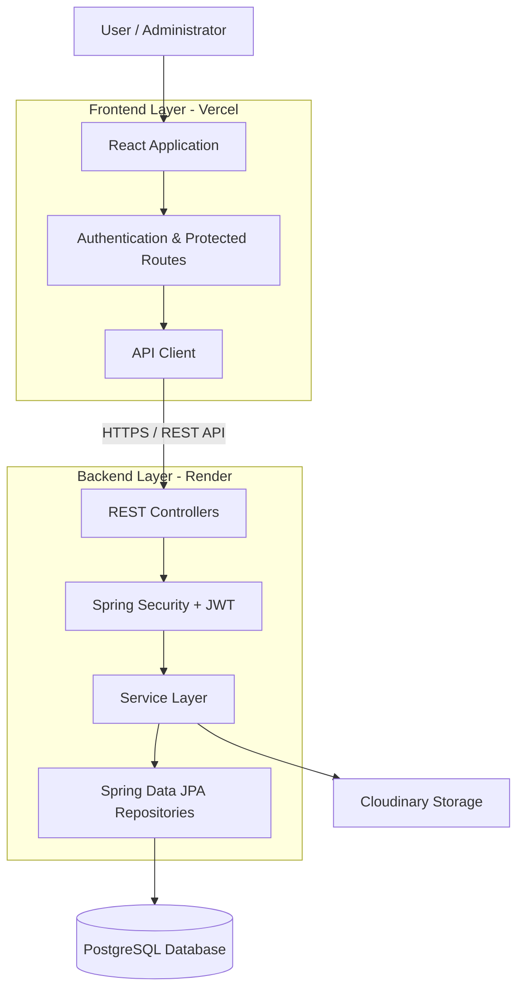
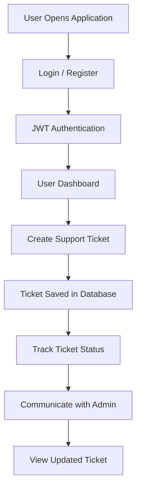
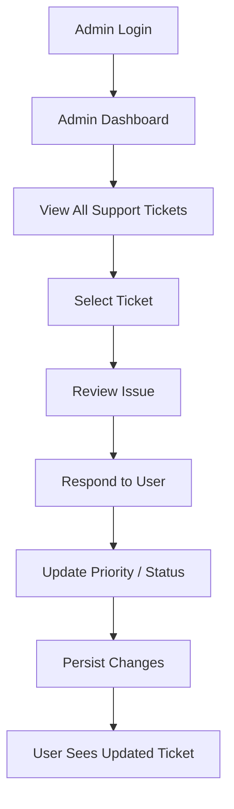

# SupportFlow — SLA-Driven Customer Support Platform

A full-stack customer support and ticket management platform built with **Java, Spring Boot, React, and PostgreSQL**. SupportFlow provides a centralized workspace for managing customer support requests, tracking ticket lifecycles, facilitating communication, and organizing support operations through role-based access control.

## Live Demo

| Component | Link |
|---|---|
| Frontend Application | `https://supportflow-flax.vercel.app/` |
| Backend API | `https://supportflow-sla-driven-customer-support.onrender.com/` |
| GitHub Repository | https://github.com/nisatsama/SupportFlow-SLA-Driven-Customer-Support-Platform |

> The frontend communicates with the deployed Spring Boot backend through a configurable API base URL.

## Overview

SupportFlow is designed to simplify customer support operations by bringing ticket management, communication, and administrative control into one platform.

Traditional support workflows often involve scattered conversations, manual ticket tracking, and limited visibility into issue resolution. SupportFlow addresses these problems through a centralized ticket management system with clearly defined user roles and structured ticket lifecycles.

The platform provides two primary roles:

- **USER:** Can create and manage personal support tickets, track their status, and communicate with administrators.
- **ADMIN:** Can access and manage support tickets across users, oversee ticket progress, and respond to customer conversations.

## Key Features

### 1. Authentication and Authorization
- JWT-based authentication.
- Role-based access control.
- Separate USER and ADMIN permissions.
- Protected API endpoints.
- OAuth2 client integration.
- Secure authentication configuration.

### 2. Ticket Management
- Create and submit support tickets.
- View personal tickets as a regular user.
- Administrative access to all tickets.
- Update ticket details and manage ticket lifecycles.
- Track ticket priority and status.

### 3. Ticket Lifecycle Management

Tickets support the following statuses:

| Status | Description |
|---|---|
| OPEN | Newly created support request |
| IN PROGRESS | Issue is being investigated |
| ON HOLD | Resolution is temporarily paused |
| RESOLVED | Issue has been addressed |
| CLOSED | Ticket lifecycle is complete |

### 4. Priority Management

Tickets can be organized according to their priority, helping administrators identify and handle important support requests.

### 5. Ticket Conversations
- Thread-based communication between users and administrators.
- Messages associated with individual tickets.
- Centralized conversation history.
- Role-based access to ticket discussions.

### 6. File and Media Management
- Cloudinary integration for cloud-based media storage.
- Configurable storage credentials.
- Backend integration for handling uploaded media.

### 7. Production Deployment
- React frontend deployed on Vercel.
- Spring Boot backend containerized using Docker.
- Backend deployment configured for Render.
- PostgreSQL database configured through environment variables.
- Configurable CORS and API endpoints.
- Environment-based production configuration.

---

## System Architecture

SupportFlow follows a **client-server architecture** with a React frontend, Spring Boot REST API, PostgreSQL database, and Cloudinary integration.

### High-Level Architecture



### Architecture Components

**1. Presentation Layer — React**

The frontend provides the user interface for authentication, ticket creation, ticket tracking, administration, and conversations.

Responsibilities:
- Render application pages and reusable UI components.
- Handle user interactions and form submissions.
- Maintain authentication state.
- Communicate with the backend using HTTP requests.
- Display ticket information and status updates.

**2. API Layer — Spring Boot**

The backend exposes RESTful endpoints consumed by the React application.

Responsibilities:
- Process incoming HTTP requests.
- Validate request data.
- Enforce authentication and authorization.
- Coordinate ticket and messaging operations.
- Return structured API responses.

**3. Security Layer — Spring Security and JWT**

Spring Security protects backend resources.

The authentication workflow:

1. A user submits their login credentials.
2. The backend validates the credentials.
3. A JWT is issued after successful authentication.
4. The frontend uses the token for authenticated API requests.
5. Spring Security validates the token and applies authorization rules.
6. Access is granted according to the authenticated user's role.

**4. Business Logic Layer**

The service layer contains the application's core business operations.

It separates business rules from HTTP controllers and database access, making the application easier to maintain and extend.

**5. Persistence Layer — PostgreSQL and Spring Data JPA**

PostgreSQL stores application data, including user accounts, support tickets, and ticket conversations.

Spring Data JPA handles database interactions through repository abstractions.

**6. Media Storage — Cloudinary**

Cloudinary provides external cloud storage for supported media and file operations, avoiding the need to store uploaded media directly in the application server's local filesystem.

---

## Application Workflow

### User Workflow



### Administrator Workflow



---

## Technology Stack

| Layer | Technologies |
|---|---|
| Frontend | React, JavaScript, Tailwind CSS |
| Backend | Java 21, Spring Boot |
| API | Spring Web MVC, REST |
| Security | Spring Security, JWT, OAuth2 Client |
| ORM | Spring Data JPA, Hibernate |
| Database | PostgreSQL |
| Media Storage | Cloudinary |
| Build Tool | Maven, npm |
| Containerization | Docker |
| Frontend Hosting | Vercel |
| Backend Hosting | Render |
| Database Hosting | PostgreSQL-compatible managed database |

---

## Project Structure

```text
SupportFlow-SLA-Driven-Customer-Support-Platform/
│
├── backend/
│   └── HelpDeskTicketManagementSystem/
│       ├── src/
│       │   ├── main/
│       │   │   ├── java/
│       │   │   │   └── helpdesk/in/
│       │   │   │       └── HelpDeskTicketManagementSystem/
│       │   │   │           ├── controller/
│       │   │   │           ├── service/
│       │   │   │           ├── repository/
│       │   │   │           ├── entity/
│       │   │   │           ├── dto/
│       │   │   │           ├── config/
│       │   │   │           └── security/
│       │   │   └── resources/
│       │   └── test/
│       ├── Dockerfile
│       └── pom.xml
│
├── frontend/
│   ├── src/
│   ├── public/
│   ├── package.json
│   └── vercel.json
│
├── README.md
└── .gitignore
```

*The directory structure above illustrates the architectural organization; individual package names may differ in the repository.*

---

## Running Locally

### Prerequisites

- Java 21
- Maven
- Node.js and npm
- PostgreSQL
- Git

### 1. Clone the Repository

```bash
git clone https://github.com/nisatsama/SupportFlow-SLA-Driven-Customer-Support-Platform.git

cd SupportFlow-SLA-Driven-Customer-Support-Platform
```

### 2. Configure the Backend

Navigate to the backend directory:

```bash
cd backend/HelpDeskTicketManagementSystem
```

Configure the required environment variables:

```env
DB_URL=jdbc:postgresql://localhost:5432/supportflow
DB_USERNAME=your_database_username
DB_PASSWORD=your_database_password

JWT_SECRET=your_secure_jwt_secret

CLOUDINARY_CLOUD_NAME=your_cloud_name
CLOUDINARY_API_KEY=your_api_key
CLOUDINARY_API_SECRET=your_api_secret

CORS_ALLOWED_ORIGINS=http://localhost:5173
```

Use your local PostgreSQL database and ensure the required credentials are configured.

### 3. Start the Backend

```bash
mvn clean install
mvn spring-boot:run
```

The backend runs on:

```text
http://localhost:8080
```

### 4. Configure the Frontend

Navigate to the frontend directory:

```bash
cd frontend
```

Create a `.env` file:

```env
VITE_API_BASE_URL=http://localhost:8080/api
```

Install dependencies:

```bash
npm install
```

### 5. Start the Frontend

```bash
npm run dev
```

The frontend runs on:

```text
http://localhost:5173
```

---

## Production Deployment

SupportFlow uses separate deployment environments for its frontend and backend.

### Frontend — Vercel

1. Import the frontend project into Vercel.
2. Configure the frontend root directory.
3. Add `VITE_API_BASE_URL` pointing to the deployed backend API.
4. Configure production environment variables.
5. Deploy the application.

### Backend — Render

1. Connect the GitHub repository to Render.
2. Configure the backend Dockerfile.
3. Set the required production environment variables.
4. Configure the PostgreSQL database connection.
5. Set the allowed frontend origin in `CORS_ALLOWED_ORIGINS`.
6. Deploy the backend service.

### Production Environment Variables

| Variable | Purpose |
|---|---|
| `PORT` | Backend server port |
| `DB_URL` | PostgreSQL JDBC connection URL |
| `DB_USERNAME` | Database username |
| `DB_PASSWORD` | Database password |
| `JWT_SECRET` | JWT signing secret |
| `CLOUDINARY_CLOUD_NAME` | Cloudinary account |
| `CLOUDINARY_API_KEY` | Cloudinary API key |
| `CLOUDINARY_API_SECRET` | Cloudinary API secret |
| `CORS_ALLOWED_ORIGINS` | Permitted frontend origins |

**Security:** Never commit production credentials, API keys, database passwords, or JWT secrets to GitHub.

---

## Engineering Decisions

- **Separation of concerns:** Controllers, services, and repositories have distinct responsibilities.
- **Stateless authentication:** JWT-based authentication allows the backend to validate authenticated requests without maintaining traditional server-side sessions.
- **Role-based authorization:** Different application capabilities are exposed to users and administrators.
- **Centralized API configuration:** The frontend uses an environment-driven API base URL, allowing the same codebase to work locally and in production.
- **Containerized backend:** Docker provides a consistent runtime environment for backend deployment.
- **External media storage:** Cloudinary separates media storage from the application server.
- **Relational persistence:** PostgreSQL provides structured storage for tickets, users, and conversations.

## Future Enhancements

- Automated SLA deadline calculation and breach detection.
- Ticket assignment and support-agent workload management.
- Automated email and in-app notifications.
- Ticket analytics and resolution-time dashboards.
- Advanced ticket filtering and pagination.
- Escalation workflows for overdue tickets.
- Comprehensive integration and end-to-end testing.

## Author

**Nisat Sama**

B.Tech Computer Science and Engineering

GitHub: [@nisatsama](https://github.com/nisatsama)

---

*SupportFlow — Bringing structure, visibility, and accountability to customer support.*
